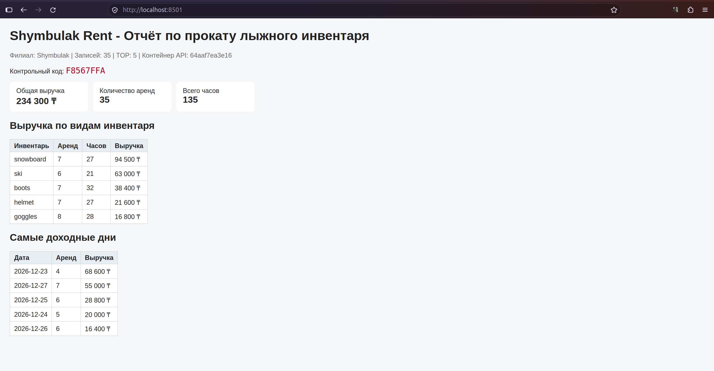

# Shymbulak Rent - Отчёт по прокату инвентаря (Вариант 1)

**Выполнил:** Турсунов Пархатжан Азизович

## Контрольный код
Мой уникальный контрольный код из отчета: **F8567FFA**

## Финальный дашборд


## Описание проекта
Проект представляет собой контейнеризированное веб-приложение для анализа данных проката лыжного инвентаря. 
Состоит из двух сервисов, объединенных через Docker Network (`shym-net`):
1. **API-сервер** (Python/Alpine) — обрабатывает CSV-данные, прогоняет юнит-тесты при многоэтапной сборке и отдает JSON-отчет.
2. **Web-сервер** (Nginx) — раздает статический HTML/JS дашборд и проксирует запросы к API.

## Как запустить проект локально
```bash
docker network create shym-net
docker container run -d --name shym-api --network shym-net shym-rent:v3
docker container run -d --name shym-web -p 8501:80 --network shym-net -v $(pwd)/web:/usr/share/nginx/html:ro -v $(pwd)/web/nginx.conf:/etc/nginx/conf.d/default.conf:ro nginx:alpine